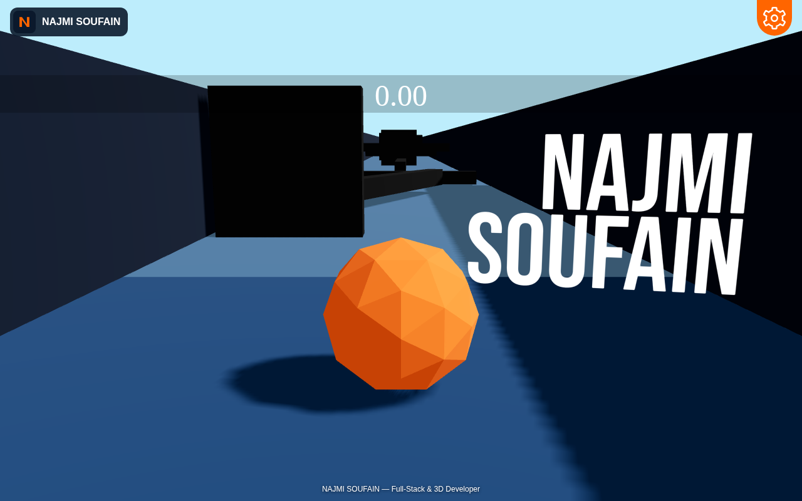

# NAJMI SOUFAIN — Full-Stack & 3D Developer

Building modern web applications, immersive 3D experiences and intelligent digital solutions.

An interactive 3D racing experience built with React, React Three Fiber, Rapier and Vite. The original game layout, physics, theme selection, music and desktop/mobile controls are preserved.



## Development

Use Node.js 18 or newer and npm:

```sh
npm install
npm run dev
```

Open the local address printed by Vite. Select START, then use WASD or the arrow keys to move and Space to jump. Mobile devices provide touch controls. Settings provide theme and sound controls.

## Production

```sh
npm run build
```

Deploy the generated `dist/` directory. Before publishing, set the Open Graph and Twitter image URLs in `src/index.html` to the absolute URL on your actual production domain. Add canonical and `og:url` metadata once that domain is known.

## Branding

The reusable logo is in `src/components/interface/Logo.jsx`, using the modern N symbol in `public/favicon.svg`. The same identity appears in the start screen, header, footer, 3D title, browser metadata and web manifest.

## Asset attribution

The Cup trophy model by SebDD is licensed under CC BY 4.0. Its original attribution is preserved in `public/scene.gltf`:
https://sketchfab.com/3d-models/cup-trophy-129d53177cae4df69a40e492c6cda8eb
